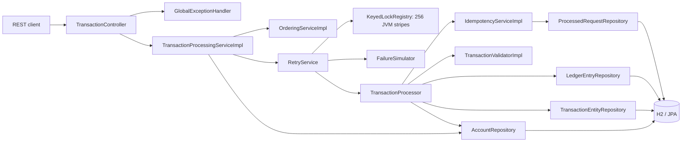

# Design: Idempotent Transaction Processing Service

## Problem Statement

The attached CTS assessment describes an enterprise transaction service that must tolerate duplicate and out-of-order input, transient processing failures, and client retries without causing duplicate balance updates or ledger entries. It expects clear transaction state, validation, a defined ordering strategy, operational counts, and tests, while allowing a lightweight input source and persistence layer.

This implementation provides those core transaction controls behind synchronous REST APIs. It is designed to be replaceable at the input boundary, but is not itself an asynchronous queue consumer. `accountNumber` is used as the account reference in the API instead of the assessment's generic `accountId`.

## Architecture



The controller handles HTTP mapping and delegates business work. The application service maps request DTOs to domain entities, handles batch grouping and response mapping. Processing rules are kept in validator, ordering, idempotency, retry, and transaction processor components. Spring Data repositories own persistence and database locking.

## Component Responsibilities

| Component | Responsibility |
| --- | --- |
| `TransactionController` | Exposes the transaction endpoints, applies request validation, maps transaction outcomes to HTTP status codes. |
| `GlobalExceptionHandler` | Maps validation, malformed-body, not-found, conflict, and unexpected exceptions to the common `ApiErrorResponse`. |
| `TransactionProcessingServiceImpl` | Resolves accounts, maps DTOs, groups/orders batch work per account, releases persisted pending rows, creates response DTOs, and aggregates the summary. |
| `TransactionValidatorImpl` | Checks transaction and request identifiers, account reference, positive amount/sequence, supported currency, and account currency agreement. |
| `OrderingServiceImpl` | Sorts valid transactions per account, uses the last processed sequence as a baseline, marks gap-ahead records `PENDING`, and marks stale sequence values `REJECTED`. |
| `RetryService` | Serializes work by request and transaction keys within one JVM, invokes the processor, retries transient failures, and persists retry/final status. |
| Application logging | SLF4J records transaction result, retry, exhaustion, and rejected batch-item events using transaction identifiers and status only. |
| `FailureSimulator` | Deterministically fails `TXN-2005` on its first attempt and always fails `TXN-RETRY-EXHAUSTED`; this is test/assessment behavior, not a production failure policy. |
| `TransactionProcessor` | Runs idempotency checks and the atomic transaction/account/ledger update. Also provides a lower-level batch entry point that follows the same ordering rules. |
| `IdempotencyServiceImpl` | Claims request IDs using a SHA-256 request hash, checks transaction ID uniqueness, and records duplicate attempts. |
| `KeyedLockRegistry` | Provides 256 bounded JVM lock stripes. Hash collisions may add contention, but do not change correctness. |
| Repositories and entities | Persist accounts, transactions, ledger entries, and processed-request/duplicate-attempt records; use unique constraints and pessimistic account/row locks. |

## Request Processing and Transaction Consistency

For a single request:

1. Spring MVC validates the request DTO.
2. The application service resolves the account and maps the DTO to a transaction entity. If omitted, `transactionId` falls back to `idempotencyKey`, then `externalRequestId`.
3. `RetryService` acquires request/transaction stripes and invokes the deterministic failure simulator.
4. `TransactionProcessor` validates domain rules and checks transaction ID, request ID, and idempotency key before applying effects.
5. Within one database transaction, the processor claims the request, saves the transaction, locks the account row, updates the balance, writes one ledger entry, and sets the transaction status to `PROCESSED`.
6. The transaction commits as a unit. A processing exception rolls back these changes before `RetryService` records `RETRY_PENDING` or `FAILED`.

The account update and ledger insert are atomic with the transaction's final state and idempotency claim. An account write lock prevents concurrent transactions from overwriting each other's balance updates. Unique database constraints provide a second duplicate safeguard beyond JVM locking.

For `CREDIT` and `ADJUSTMENT`, amount is added to the account balance. For `DEBIT` and `TRANSFER`, amount is subtracted. The current implementation does not model a two-sided transfer or enforce an insufficient-funds rule.

## Transaction Lifecycle

```mermaid
stateDiagram-v2
    [*] --> RECEIVED
    RECEIVED --> PROCESSING: valid and accepted
    PROCESSING --> PROCESSED: balance and ledger commit
    PROCESSING --> RETRY_PENDING: transient failure and retries remain
    RETRY_PENDING --> PROCESSING: next inline attempt
    PROCESSING --> FAILED: non-transient failure or retries exhausted
    RECEIVED --> FAILED: domain validation failure
    RECEIVED --> DUPLICATE: duplicate request / transaction / key
    RECEIVED --> PENDING: future sequence; gap exists
    PENDING --> PROCESSED: required sequence arrives
    PENDING --> REJECTED: sequence becomes stale
```



`RECEIVED` and `PROCESSING` are set inside the processor transaction that also commits `PROCESSED`. Other database transactions will generally observe only the terminal state, not the intermediate `PROCESSING` value. `DUPLICATE` describes the response/attempt; the original `TransactionEntity` remains unchanged. Duplicate attempt details are recorded in `ProcessedRequest`, so they remain available as long as the configured database retains its data. The current in-memory H2 configuration loses all records when the application exits.

The status enum also contains `RETRY_SCHEDULED` and `OUT_OF_ORDER` for compatibility/reporting, but the current inline retry path uses `RETRY_PENDING`; ordering currently holds future sequences as `PENDING` and rejects stale ones as `REJECTED`.

## Idempotency and Duplicate Detection

Three identifiers participate in duplicate handling:

- `transactionId`: unique business transaction identifier; enforced by a database unique constraint.
- `externalRequestId`: request/replay identifier; normalized by trimming and hashed with SHA-256 for the processed-request claim. Reuse of the same request ID is a duplicate even if the body differs; the request body is not compared for semantic equivalence.
- `idempotencyKey`: optional caller key; unique on the transaction row and checked before processing.

Duplicate requests return status `DUPLICATE` and do not write a second ledger entry or update the account again. Request-ID repeats increment a durable duplicate-attempt count; transaction-ID and idempotency-key collisions create a duplicate record. Cross-instance insert races are resolved by database uniqueness constraints and classified after rollback. The in-memory striped locks only coordinate threads within a single application process.

## Ordering Strategy

The service uses sequence numbers independently per account:

- The batch is grouped by account and sorted by sequence number, then transaction ID for deterministic ties.
- The highest persisted `PROCESSED` sequence is the baseline.
- The first sequence after the baseline is processed; later contiguous values can follow in the same batch.
- If a sequence is missing, higher values are persisted as `PENDING` without changing the balance or ledger.
- On a later batch for that account, persisted pending rows are merged with incoming rows and re-evaluated. Filling the earliest gap releases the now-contiguous pending sequence chain.
- Values at or below the processed baseline are `REJECTED` as stale.
- When an account has no processed sequence yet, the first valid sequence in the ordered input establishes its starting point. The implementation does not require the initial sequence to be `1`.

This is sequence-based buffering, not event-time ordering. There is no timeout or operator action for a permanently missing sequence; pending rows remain stored until a later input fills the gap.

## Retry Mechanism

`transaction.retry.max-retries` controls the number of retries after the initial attempt and defaults to `3`. `RetryService` retries `TransientProcessingException` and Spring `TransientDataAccessException`. Each failed attempt rolls back the transaction update before retry state is saved. Exhaustion marks the transaction `FAILED`. Duplicate database conflicts are treated as duplicate outcomes rather than retryable failures.

The retry loop runs synchronously in the request thread. There is no delay/backoff, jitter, scheduled retry, persistent queue, dead-letter queue, or automatic recovery scan. The assessment simulator uses:

- `TXN-2005`: first attempt fails, next attempt succeeds.
- `TXN-RETRY-EXHAUSTED`: every attempt fails, ending in `FAILED` after the configured retry limit.

## API Reference

The API uses `accountNumber` and `externalRequestId`; it does not expose a separate account-creation operation. All routes, payloads, HTTP status mappings, and sample JSON are documented in [README.md](README.md).

| Method and path | Behavior |
| --- | --- |
| `POST /api/transactions/process` | Process one request. `200` processed, `409` duplicate, `422` failed; request validation errors are `400`. `202` is reserved for pending statuses but is not emitted by the current synchronous single-request path. |
| `POST /api/transactions/batch` | Validate a 1-500 item batch, order per account, return per-item responses and counters. |
| `GET /api/transactions/{transactionId}` | Retrieve a stored transaction or return `404`. |
| `GET /api/transactions/summary` | Return total, processed, duplicate, retry, out-of-order, and failed counts. |

### Batch Validation and Failure Reporting

Each batch item is validated independently. Invalid field values, unsupported or mismatched currencies, null items, and missing accounts produce per-item `FAILED` responses, while valid siblings continue processing. Invalid batch items are not persisted as transaction entities, so they do not appear in the global summary or lookup endpoint. Malformed JSON and invalid top-level batches (empty or over 500 items) still reject the whole request with `400`.

## Assessment Requirement Mapping

| Assessment expectation | Current implementation |
| --- | --- |
| Replaceable input source | REST controller delegates to an application service; no queue/file adapter exists yet. |
| Mandatory field validation | Single requests use DTO validation; batch requests return per-item failure responses for invalid items. Malformed JSON/top-level batch shape rejects the request. |
| Transaction state lifecycle | Persisted transaction states and retry/pending/duplicate outcomes are implemented; `PROCESSING` is not externally observable as a committed intermediate state. |
| Process a unique transaction once | Account/ledger work is atomic; request, transaction, and key uniqueness plus locks prevent duplicate effects. |
| Detect duplicates later in a batch | Duplicate checks happen per item; duplicate attempts are recorded in the processed-request store. |
| Out-of-order handling | Per-account sequence buffering with durable `PENDING` rows and later release. |
| Simulated transient failure and safe retry | `TXN-2005` and exhaustion scenario are deterministic; retry count is configurable. |
| Processing summary | Individual lifecycle status counts and duplicate attempts are reported. Invalid batch response-only items are not counted. The current implementation loads rows to aggregate and is not designed for very large tables. |
| Edge-case tests | The suite covers REST, per-item batch failures, validation, ordering/gaps, duplicates, concurrency, retries, and summaries. |

## Build and Test

Requirements: Java 17 or later. Maven Wrapper scripts are included.

```powershell
.\mvnw.cmd clean test
```

```sh
./mvnw clean test
```

Run the service locally:

```powershell
.\mvnw.cmd spring-boot:run
```

```sh
./mvnw spring-boot:run
```

The current test suite is Spring Boot/JPA-backed and uses H2. For the configured in-memory database, data is discarded when the application process exits.

## Trade-offs and Assumptions

- REST was selected as the lightweight, replaceable intake mechanism allowed by the assessment; processing is synchronous rather than background.
- Sequence order is per account. The first valid sequence establishes the initial baseline if no prior processed sequence exists.
- Reusing an `externalRequestId` means duplicate regardless of payload differences; callers must provide stable request identifiers.
- `idempotencyKey` is optional; when present it is unique and also serves as a fallback transaction ID if `transactionId` is absent.
- The database is H2 in-memory with `ddl-auto=update`; it demonstrates persistence semantics but does not survive restart or provide production durability.
- The 256 striped locks are process-local and bounded. Database constraints and locks are still required for correctness across multiple service instances.
- `TRANSFER` currently debits the source account only. A complete transfer requires destination resolution and a two-account atomic ledger operation.
- No insufficient-funds rule, authentication, authorization, rate limiting, or account creation API is implemented.
- Batch response counters separately report processed, duplicate, and failed records; pending/rejected records remain visible in the per-item `transactions` array.

## Production Hardening Recommendations

1. Replace H2 with a durable relational database and versioned migrations. Keep unique constraints and transactional account/ledger updates.
2. Introduce a queue or durable work table with account-key partitioning, consumer acknowledgements, visibility timeouts, and restart recovery.
3. Move retries to a scheduler/queue with exponential backoff, jitter, retry timestamps, maximum delivery count, and a dead-letter workflow.
4. Persist per-item batch validation failures or publish them to an audit/reporting sink so rejected records remain traceable and included in operational counts.
5. Define transfer semantics, insufficient-funds behavior, reversal rules, and a currency/precision policy before production use.
6. Add structured logs with correlation/request/transaction IDs, counters/timers, traces, and alerts for pending age, retries, failures, and duplicate rates. Avoid logging sensitive payloads.
7. Add authentication/authorization, rate limits, payload-size limits, secret management, and restrict or disable the H2 console.
8. Replace full-table summary scans with indexed aggregate queries or metrics, and add retention/archival for transaction and duplicate-attempt records.
9. Test database concurrency across multiple application instances; JVM stripes are only an optimization, not a distributed lock.
10. Add operational recovery controls for permanently pending sequence gaps, including gap-age reporting, replay, and operator-approved skip/reject policies.

## AI-Assisted Development

AI assistance was used during implementation. Generated changes were checked against the assessment requirements, reviewed against the current persistence/transaction boundaries, and validated with the automated test suite. The tests verify observable account and ledger effects rather than only service mock interactions.
